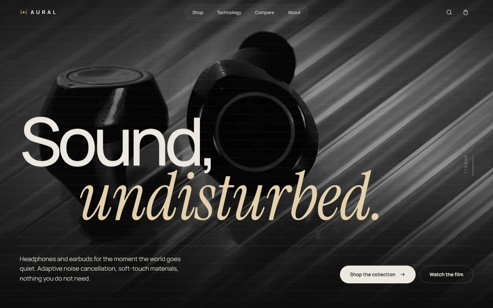

# AURAL — premium headphones & earbuds concept store (frontend demo)

Live demo: https://aural-store.vercel.app



> Concept project designed and built by [Zain Ali Arif](https://zainaliarif.com).

A premium audio e-commerce frontend for **AURAL**, a fictional headphones and earbuds concept: dark editorial home page,
a scroll-scrubbed product film, cursor-reactive motion, a complete demo shop and an honest asset pipeline. AURAL is a temporary demo name, not a
registered brand. Products, prices, availability and specifications are illustrative; nothing can be purchased.

## Run it

```bash
npm install
npm run dev        # http://localhost:5183
npm run lint       # ESLint
npm run build      # production build in dist/
npm run preview    # serve the build locally
```

**On a phone:** connect the phone to the same Wi-Fi as the computer, run `npm run preview:phone` (builds, then
serves on the network) or `npm run dev:phone`, and open the `Network:` address it prints (for example
`http://192.168.x.x:4183`). Plain `npm run dev` / `npm run preview` only answer on this computer, so `localhost`
links do not open on a phone. If the phone cannot connect, allow Node.js through Windows Firewall.

## Stack

React 19, React Router 7, Vite, GSAP + ScrollTrigger, Lenis (smooth scrolling on GSAP's ticker). Manrope and
Instrument Serif are self-hosted (Fontsource). No analytics, cookies or third-party scripts. three.js is a dev
dependency only, used offline to produce the concept renders; the site itself ships no WebGL.

## Routes

`/` · `/shop` · `/products/:id` · `/compare` · `/bag` · `/checkout` · `/about` · `/contact` · `/faq` · `/shipping` ·
`/returns` · `/privacy` · `/terms` · `/credits` · anything else → 404. All routes except home are lazy-loaded.

## Structure

```
src/
  config/brand.js        name, copy, placeholders, siteUrl for canonical tags   ← rebrand here
  data/products.js       the 8 demo products (single source for every page)
  data/assets.js         central image registry: photos + concept renders, srcset helpers
  data/credits.js        photographer, videographer and licence data for every photo and clip
  lib/smooth.js          Lenis smooth scrolling, scrollToTarget, scroll lock (off under reduced motion)
  lib/motion.js          prefersReducedMotion()
  lib/gsap.js            registers GSAP plugins once
  pages/                 Home, Shop, Product, Compare, Bag, Checkout, InfoPages (+ Credits), NotFound
  components/            Nav, SearchDialog, Footer, ProductCard, ProductImage, QuickView, BagDrawer,
                         Film (scroll film), SoundField (pointer waveform), Cursor, Preloader…
  state/bag.jsx          bag reducer (add, quantity, colour change, remove, clear) + localStorage
  styles/                base.css (design system), home.css, store.css
  three/                 dev-only 3D models and studio lighting for the concept renders
  render/                dev-only offline renderer for the concept renders
scripts/
  photo-manifest.mjs     which Pexels photos are used, crops and processing mode
  process-photos.mjs     crops, keys backdrops, bakes the studio backdrop, exports WebP (1600/800)
  render-products.mjs    renders the concept-render products onto the same backdrop
  backdrop.js            the shared "studio pearl" backdrop
  extract-frames.mjs     cuts the Pexels clips into graded WebP frame sequences for the film
public/images/photos     processed photography      public/images/renders   concept renders
public/media             hero.mp4 + poster, seq/<chapter>/{lg,sm}/NNN.webp (film frames)
```

## Design system

"After hours": a dark editorial system. Tokens at the top of `src/styles/base.css`: near-black surfaces
`--g-0 #0C0C0C` … `--g-3 #242422`, bone text `#ECE7DF` (secondary `#C8C2B8`, muted `#8C877F`), one accent,
champagne `#C9A978`, and a light studio tone `#EFEBE5` for product tiles (it matches the backdrop baked into the
images). Manrope for UI and body, Instrument Serif italic for one accent word per headline. A fine film-grain
overlay, a 4 px spacing scale, small radii and shared easing. Buttons fill like liquid on hover.

## Product imagery — read this

- **Photography (Pro X, One, Studio):** licensed stock photos from Pexels (Pexels License, free for commercial use).
  Every photo was checked for visible logos; the products are **unbranded stand-ins** for this fictional concept.
  Full credits are on `/credits` and in `src/data/credits.js`.
- **Concept renders (Air, Pulse, Neo, Sport, Mini):** no legitimately reusable, unbranded photography was found for
  these designs (free stock photos of earbuds overwhelmingly show identifiable brands such as Apple, Nothing, Amazon,
  Bang & Olufsen, JBL, Jabra, OPPO and Philips). They are shown as clearly labelled concept renders.
- All images share one 4:5 frame and one baked studio backdrop, and every product photo is framed around the whole
  product and shown with object-fit: contain, so nothing is ever cropped.

To replace an image: process a new photo with `scripts/process-photos.mjs` (add it to the manifest), then point the
colour's `images` list in `src/data/products.js` at the new key in `PHOTO_ASSETS`.

```bash
# originals are not committed; download the Pexels originals listed in scripts/photo-manifest.mjs, then:
node scripts/process-photos.mjs <folder with <pexelsId>.jpg files>
npm run render:products          # concept renders (needs local Chrome/Edge)
```

## Home page motion

- **Preloader:** wordmark rises while a counter runs to 100, then the curtain lifts. Once per session, home only.
- **Hero:** muted black-and-white video loop with a canvas "sound field": waveform lines that bend toward the
  pointer and ripple outward where it moves. Static on touch devices.
- **Custom cursor:** a dot plus a lagging ring (blend mode difference) that grows over links and shows labels such
  as "View" or "Explore" (`data-cursor`). Fine pointers only.
- **Film** (`src/components/Film.jsx`): an Apple-style scroll-scrubbed image sequence in four chapters (the case,
  opening, from above, in the hand), 180 frames drawn to a sticky canvas, with dips to black between chapters,
  a slow push-in and captions tied to scroll. Scrolling up plays it backwards. Frames load progressively (key frames
  first) and phones get smaller frames. The footage is real video of an **unbranded stand-in product**
  (H.Espinosa Films, Pexels License), not an AURAL design; it is credited on the page and on `/credits`.
- **Pro X film** (`src/components/ProXFilm.jsx`, same `Film` component): an original scroll film rendered from the
  procedural model by `scripts/render-film.mjs` (`npm run render:film`): the earbuds float in the dark, the case turns on
  a glossy floor, the lid opens and the light wakes, the earbuds rise. 4 × 45 frames in two cuts: wide 1600×900 for
  laptops and desktops, tall 720×1280 for portrait screens, so the product fills every screen. No stock footage and no
  third-party brand.
- **Also:** word-by-word manifesto scrub, stat counters, velocity-driven marquee, pinned horizontal product rail
  (desktop; native swipe on smaller screens), category list with a cursor-following preview, 3D-tilt spotlight,
  parallax brand story and magnetic buttons.
- **Reduced motion:** no preloader, cursor, smooth scrolling or scrubbing; the film becomes four still chapters and
  all content is visible immediately.

```bash
# the film frames are committed; to regenerate them, download the five Pexels clips (ids in
# scripts/extract-frames.mjs) as <id>.mp4 into one folder, then:
node scripts/extract-frames.mjs <folder>
```

Weight: hero video 2.5 MB; film frames 3.7 MB (desktop) or 2.1 MB (mobile); Pro X film frames are loaded only as that film approaches.

## Simulated, not real

Products, prices, availability, badges and specifications are demo data. Checkout validates a delivery form but never
asks for payment, places no order and stores nothing. The contact form is not connected. Contact details, social links,
shipping, returns, privacy and terms are labelled placeholders.

## Before a real launch

Real product photography and verified specifications · business and contact details · payment provider · shipping,
returns, privacy and terms · a domain (set `brand.siteUrl`) · `robots.txt`, `sitemap.xml`, og:image · hosting with an
SPA fallback (e.g. Netlify `/* /index.html 200`).

## SEO note

Client-rendered SPA: titles, descriptions and Open Graph tags are set per route at runtime (Google renders them), but
crawlers that do not run JavaScript only see the defaults in `index.html`. Pre-rendering would fix that.
